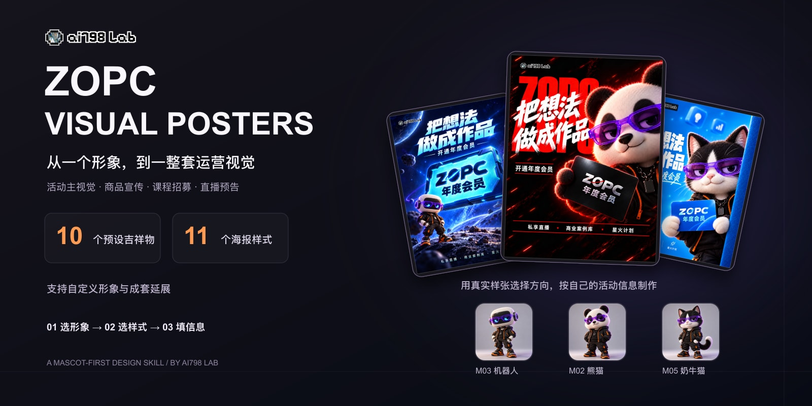

<a name="readme-top"></a>

<div align="center">



<h1>ZOPC Visual Posters</h1>
<h3>Choose a character. Build your campaign visuals.</h3>

<p>A conversational design skill for events, products, courses and livestreams.<br>10 mascot presets, 11 visual styles, and your own campaign information.</p>

<p><a href="README.md">简体中文</a> · <strong>English</strong></p>

<p><a href="docs/INSTALL.en.md">Install</a> · <a href="docs/POSTERS.md">Browse styles</a> · <a href="docs/MASCOTS.md">Meet the mascots</a> · <a href="https://github.com/ai798-Lab/zopc-commercial-visual-posters/issues/new/choose">Feedback</a></p>

[](https://github.com/ai798-Lab/zopc-commercial-visual-posters/actions/workflows/verify-assets.yml)
[](docs/MASCOTS.md)
[](docs/POSTERS.md)
[](skills/zopc-commercial-visual-posters/references/characters.md)

</div>

<details>
<summary>Table of contents</summary>

- [Why this skill](#why-this-skill)
- [Get started](#get-started)
- [The workflow](#the-workflow)
- [Visual library](#visual-library)
- [Documentation](#documentation)
- [Local checks](#local-checks)
- [Contributing](#contributing)
- [Usage and brand](#usage-and-brand)

</details>

## Why this skill

Start with a recognizable character and a visual direction, then use your actual campaign information.

- **Choose from real examples:** 10 mascot presets and 11 numbered poster styles.
- **Combine freely:** the mascot in a style example does not lock your final character.
- **Bring your own character:** upload an existing mascot or describe a new one.
- **Extend a campaign:** continue into product details, benefit cards, livestream announcements, countdowns and horizontal covers after the first poster.

This is a conversational workflow, not an image model. Production requires an image generation or editing capability in your client. The supplied Python helpers validate information and assets; they do not generate the final poster.

The skill instructions and example artwork currently use Chinese. This English README documents the same package; it does not claim a translated product interface.

[Back to top ↑](#readme-top)

## Get started

In a Codex conversation:

```text
$skill-installer install https://github.com/ai798-Lab/zopc-commercial-visual-posters/tree/main/skills/zopc-commercial-visual-posters
```

Then start a new conversation:

```text
Use $zopc-commercial-visual-posters to create an event poster.
Show me the mascots and numbered styles first.
```

You may also provide M03, S08, your title, platform, aspect ratio, brand and call to action together. Already supplied information should not be requested again. Price, date, logo and QR code are optional.

[Installation guide](docs/INSTALL.en.md) · [Help](docs/SUPPORT.md)

## The workflow

**Choose a mascot → View numbered styles → Choose a style → Supply campaign information → Generate and review → Decide whether to extend**

An uploaded-character request waits for the actual image when it is missing. QR posters use the user's current original QR asset and require a separate check. Output is delivered locally; this skill does not publish to external platforms.

## Visual library

### Mascot overview

10 presets plus C01, a custom elephant example. C01 is not an eleventh preset.

[](skills/zopc-commercial-visual-posters/assets/galleries/mascots.png)

[Individual mascot visuals and features](docs/MASCOTS.md)

### Poster overview

Eleven distinct visual directions. Each example uses a different character; your chosen character takes precedence.

[](skills/zopc-commercial-visual-posters/assets/galleries/styles-all.png)

[Individual poster visuals and original PNGs](docs/POSTERS.md)

### Individual mascots

<details>
<summary>Open the 10 individual mascot previews and PNG links</summary>

<table>
<tr>
<td align="center" width="33%"><a href="skills/zopc-commercial-visual-posters/assets/mascots/M01.png"></a><br><strong>M01 橙色柴犬</strong><br><a href="skills/zopc-commercial-visual-posters/assets/mascots/M01.png">Full PNG</a></td>
<td align="center" width="33%"><a href="skills/zopc-commercial-visual-posters/assets/mascots/M02.png"></a><br><strong>M02 熊猫</strong><br><a href="skills/zopc-commercial-visual-posters/assets/mascots/M02.png">Full PNG</a></td>
<td align="center" width="33%"><a href="skills/zopc-commercial-visual-posters/assets/mascots/M03.png"></a><br><strong>M03 机器人</strong><br><a href="skills/zopc-commercial-visual-posters/assets/mascots/M03.png">Full PNG</a></td>
</tr>
<tr>
<td align="center" width="33%"><a href="skills/zopc-commercial-visual-posters/assets/mascots/M04.png"></a><br><strong>M04 柯基</strong><br><a href="skills/zopc-commercial-visual-posters/assets/mascots/M04.png">Full PNG</a></td>
<td align="center" width="33%"><a href="skills/zopc-commercial-visual-posters/assets/mascots/M05.png"></a><br><strong>M05 奶牛猫</strong><br><a href="skills/zopc-commercial-visual-posters/assets/mascots/M05.png">Full PNG</a></td>
<td align="center" width="33%"><a href="skills/zopc-commercial-visual-posters/assets/mascots/M06.png"></a><br><strong>M06 兔子</strong><br><a href="skills/zopc-commercial-visual-posters/assets/mascots/M06.png">Full PNG</a></td>
</tr>
<tr>
<td align="center" width="33%"><a href="skills/zopc-commercial-visual-posters/assets/mascots/M07.png"></a><br><strong>M07 棕熊</strong><br><a href="skills/zopc-commercial-visual-posters/assets/mascots/M07.png">Full PNG</a></td>
<td align="center" width="33%"><a href="skills/zopc-commercial-visual-posters/assets/mascots/M08.png"></a><br><strong>M08 企鹅</strong><br><a href="skills/zopc-commercial-visual-posters/assets/mascots/M08.png">Full PNG</a></td>
<td align="center" width="33%"><a href="skills/zopc-commercial-visual-posters/assets/mascots/M09.png"></a><br><strong>M09 水獭</strong><br><a href="skills/zopc-commercial-visual-posters/assets/mascots/M09.png">Full PNG</a></td>
</tr>
<tr>
<td align="center" width="33%"><a href="skills/zopc-commercial-visual-posters/assets/mascots/M10.png"></a><br><strong>M10 小恐龙</strong><br><a href="skills/zopc-commercial-visual-posters/assets/mascots/M10.png">Full PNG</a></td>
<td></td>
<td></td>
</tr>
</table>

Custom example C01:

<a href="skills/zopc-commercial-visual-posters/assets/custom-example/C01.png"></a>

</details>

### Individual posters

<details>
<summary>Open the 11 individual poster previews and full PNG links</summary>

<table>
<tr>
<td align="center" width="33%"><a href="skills/zopc-commercial-visual-posters/assets/styles/S01.png"></a><br><strong>S01 星光开盒</strong><br>Example: 棕熊<br><a href="skills/zopc-commercial-visual-posters/assets/styles/S01.png">Full PNG</a></td>
<td align="center" width="33%"><a href="skills/zopc-commercial-visual-posters/assets/styles/S02.png"></a><br><strong>S02 年度通行证</strong><br>Example: 水獭<br><a href="skills/zopc-commercial-visual-posters/assets/styles/S02.png">Full PNG</a></td>
<td align="center" width="33%"><a href="skills/zopc-commercial-visual-posters/assets/styles/S03.png"></a><br><strong>S03 暖光开门</strong><br>Example: 柯基<br><a href="skills/zopc-commercial-visual-posters/assets/styles/S03.png">Full PNG</a></td>
</tr>
<tr>
<td align="center" width="33%"><a href="skills/zopc-commercial-visual-posters/assets/styles/S04.png"></a><br><strong>S04 巨型字雕</strong><br>Example: 小恐龙<br><a href="skills/zopc-commercial-visual-posters/assets/styles/S04.png">Full PNG</a></td>
<td align="center" width="33%"><a href="skills/zopc-commercial-visual-posters/assets/styles/S05.png"></a><br><strong>S05 银色旗舰</strong><br>Example: 自定义小象示范<br><a href="skills/zopc-commercial-visual-posters/assets/styles/S05.png">Full PNG</a></td>
<td align="center" width="33%"><a href="skills/zopc-commercial-visual-posters/assets/styles/S06.png"></a><br><strong>S06 Builder工作台</strong><br>Example: 企鹅<br><a href="skills/zopc-commercial-visual-posters/assets/styles/S06.png">Full PNG</a></td>
</tr>
<tr>
<td align="center" width="33%"><a href="skills/zopc-commercial-visual-posters/assets/styles/S07.png"></a><br><strong>S07 宇宙巨物</strong><br>Example: 机器人<br><a href="skills/zopc-commercial-visual-posters/assets/styles/S07.png">Full PNG</a></td>
<td align="center" width="33%"><a href="skills/zopc-commercial-visual-posters/assets/styles/S08.png"></a><br><strong>S08 红黑潮玩</strong><br>Example: 熊猫<br><a href="skills/zopc-commercial-visual-posters/assets/styles/S08.png">Full PNG</a></td>
<td align="center" width="33%"><a href="skills/zopc-commercial-visual-posters/assets/styles/S09.png"></a><br><strong>S09 蓝紫星轨</strong><br>Example: 兔子<br><a href="skills/zopc-commercial-visual-posters/assets/styles/S09.png">Full PNG</a></td>
</tr>
<tr>
<td align="center" width="33%"><a href="skills/zopc-commercial-visual-posters/assets/styles/S10.png"></a><br><strong>S10 蓝白毛绒</strong><br>Example: 奶牛猫<br><a href="skills/zopc-commercial-visual-posters/assets/styles/S10.png">Full PNG</a></td>
<td align="center" width="33%"><a href="skills/zopc-commercial-visual-posters/assets/styles/S11.png"></a><br><strong>S11 紫色聚光舞台</strong><br>Example: 橙色柴犬<br><a href="skills/zopc-commercial-visual-posters/assets/styles/S11.png">Full PNG</a></td>
<td></td>
</tr>
</table>

</details>

Current examples have no fixed bootcamp gift coupon, price, discount, event date or QR code. Only current assets and documentation are included in this public repository; historical originals are excluded.

## Documentation

| Need | Resource |
| --- | --- |
| Install and invoke | [English installation guide](docs/INSTALL.en.md) |
| Mascot identities and full images | [Mascot gallery](docs/MASCOTS.md) |
| Style descriptions and full images | [Poster gallery](docs/POSTERS.md) |
| Troubleshooting | [Help](docs/SUPPORT.md) |
| Workflow instructions | [SKILL.md](skills/zopc-commercial-visual-posters/SKILL.md) |
| Machine-readable index | [Catalog](skills/zopc-commercial-visual-posters/references/catalog.json) |
| Maintenance | [Maintaining the repository](docs/MAINTAINING.md) |
| Presentation research | [Repository design notes](docs/REPOSITORY-DESIGN.md) |

## Local checks

Python helpers use the standard library. Image production is provided by the client's image capability.

```bash
python3 scripts/check_repository.py
python3 skills/zopc-commercial-visual-posters/scripts/verify_assets.py
```

GitHub runs the same repository check on pushes and pull requests. File checks do not replace visual review or platform acceptance.

## Contributing

Report installation or asset problems, or suggest a new style. Include the client, mascot ID, style ID and expected versus actual behavior. Remove private or customer information from examples.

[Report a problem](https://github.com/ai798-Lab/zopc-commercial-visual-posters/issues/new?template=bug-report.yml) · [Suggest a style](https://github.com/ai798-Lab/zopc-commercial-visual-posters/issues/new?template=style-request.yml) · [Contribution guide](CONTRIBUTING.md)

## Usage and brand

Maintained by **[ai798 Lab](https://github.com/ai798-Lab)**. No open-source license has been selected for this repository. Model access and image generation credits are not included. See [usage and rights](docs/USAGE-RIGHTS.md).

[Back to top ↑](#readme-top)
