# ZOPC 商用运营视觉海报 Skill

先选吉祥物，再选海报样式，用自己的活动信息制作一套统一质感的运营视觉。由 **ai798 Lab** 整理。

适合活动主视觉、商品宣传、课程招募、直播预告及后续详情页、权益图、倒计时、横版封面。当前包含 **10 个预设吉祥物 + 自定义形象入口 + 11 个海报样式**。每个样式使用不同吉祥物示范，形象和样式可以自由组合。

[安装使用步骤](docs/INSTALL.md) · [下载 ZIP](https://github.com/ai798-Lab/zopc-commercial-visual-posters/archive/refs/heads/main.zip) · [Skill 入口](skills/zopc-commercial-visual-posters/SKILL.md)

[吉祥物总览](#吉祥物总览) · [海报总览](#海报总览) · [吉祥物单图](#吉祥物单图) · [海报单图](#海报单图) · [安装与使用](#安装与使用)

## 吉祥物总览

先选择 M01–M10；也可以上传已有形象，或用文字描述一个新形象。C01 小象是自定义示范，不计入 10 个预设。

[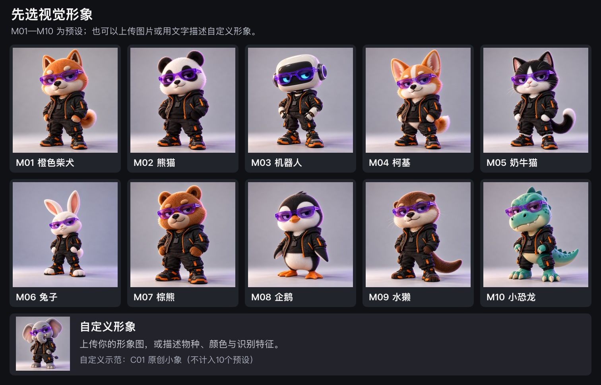](skills/zopc-commercial-visual-posters/assets/galleries/mascots.png)

[逐个查看吉祥物与识别特征](docs/MASCOTS.md)

## 海报总览

S01–S11 保留不同的字体、材质、色彩与空间氛围。图中角色只是搭配示例，实际制作采用用户先选的形象。

[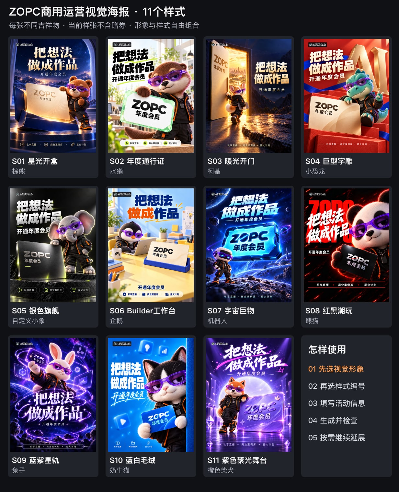](skills/zopc-commercial-visual-posters/assets/galleries/styles-all.png)

当前 11 张可选样张均已删除整块“赠 21 天实战营 ×2”；与赠送数量相关的巨型 2 已改为 AI 字雕。新海报只采用用户当次提供的品牌、文案、价格、日期和入口。

[逐张查看海报样式与适用场景](docs/POSTERS.md)

## 吉祥物单图

点击任意图片打开完整 PNG。10 个预设保持统一潮玩质感，各自保留物种特征。

<table>
<tr>
<td align="center" width="33%"><a href="skills/zopc-commercial-visual-posters/assets/mascots/M01.png"></a><br><strong>M01 橙色柴犬</strong><br><a href="skills/zopc-commercial-visual-posters/assets/mascots/M01.png">查看 PNG 原图</a></td>
<td align="center" width="33%"><a href="skills/zopc-commercial-visual-posters/assets/mascots/M02.png"></a><br><strong>M02 熊猫</strong><br><a href="skills/zopc-commercial-visual-posters/assets/mascots/M02.png">查看 PNG 原图</a></td>
<td align="center" width="33%"><a href="skills/zopc-commercial-visual-posters/assets/mascots/M03.png"></a><br><strong>M03 机器人</strong><br><a href="skills/zopc-commercial-visual-posters/assets/mascots/M03.png">查看 PNG 原图</a></td>
</tr>
<tr>
<td align="center" width="33%"><a href="skills/zopc-commercial-visual-posters/assets/mascots/M04.png"></a><br><strong>M04 柯基</strong><br><a href="skills/zopc-commercial-visual-posters/assets/mascots/M04.png">查看 PNG 原图</a></td>
<td align="center" width="33%"><a href="skills/zopc-commercial-visual-posters/assets/mascots/M05.png"></a><br><strong>M05 奶牛猫</strong><br><a href="skills/zopc-commercial-visual-posters/assets/mascots/M05.png">查看 PNG 原图</a></td>
<td align="center" width="33%"><a href="skills/zopc-commercial-visual-posters/assets/mascots/M06.png"></a><br><strong>M06 兔子</strong><br><a href="skills/zopc-commercial-visual-posters/assets/mascots/M06.png">查看 PNG 原图</a></td>
</tr>
<tr>
<td align="center" width="33%"><a href="skills/zopc-commercial-visual-posters/assets/mascots/M07.png"></a><br><strong>M07 棕熊</strong><br><a href="skills/zopc-commercial-visual-posters/assets/mascots/M07.png">查看 PNG 原图</a></td>
<td align="center" width="33%"><a href="skills/zopc-commercial-visual-posters/assets/mascots/M08.png"></a><br><strong>M08 企鹅</strong><br><a href="skills/zopc-commercial-visual-posters/assets/mascots/M08.png">查看 PNG 原图</a></td>
<td align="center" width="33%"><a href="skills/zopc-commercial-visual-posters/assets/mascots/M09.png"></a><br><strong>M09 水獭</strong><br><a href="skills/zopc-commercial-visual-posters/assets/mascots/M09.png">查看 PNG 原图</a></td>
</tr>
<tr>
<td align="center" width="33%"><a href="skills/zopc-commercial-visual-posters/assets/mascots/M10.png"></a><br><strong>M10 小恐龙</strong><br><a href="skills/zopc-commercial-visual-posters/assets/mascots/M10.png">查看 PNG 原图</a></td>
<td></td>
<td></td>
</tr>
</table>

**自定义示范 C01｜原创小象**

<a href="skills/zopc-commercial-visual-posters/assets/custom-example/C01.png"></a>

自定义可使用自己的角色原图，或描述物种、颜色和识别特征；无需选择小象作为固定角色。

## 海报单图

点击任意图片打开完整的 1086 × 1448 PNG。样式编号不与示例形象绑定。

<table>
<tr>
<td align="center" width="33%"><a href="skills/zopc-commercial-visual-posters/assets/styles/S01.png">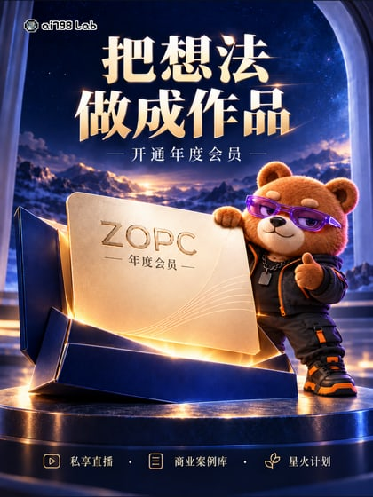</a><br><strong>S01 星光开盒</strong><br>示例：棕熊<br><a href="skills/zopc-commercial-visual-posters/assets/styles/S01.png">查看 PNG 原图</a></td>
<td align="center" width="33%"><a href="skills/zopc-commercial-visual-posters/assets/styles/S02.png">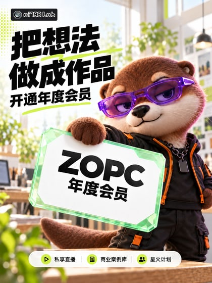</a><br><strong>S02 年度通行证</strong><br>示例：水獭<br><a href="skills/zopc-commercial-visual-posters/assets/styles/S02.png">查看 PNG 原图</a></td>
<td align="center" width="33%"><a href="skills/zopc-commercial-visual-posters/assets/styles/S03.png">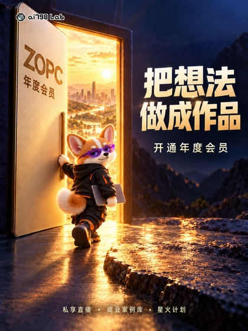</a><br><strong>S03 暖光开门</strong><br>示例：柯基<br><a href="skills/zopc-commercial-visual-posters/assets/styles/S03.png">查看 PNG 原图</a></td>
</tr>
<tr>
<td align="center" width="33%"><a href="skills/zopc-commercial-visual-posters/assets/styles/S04.png">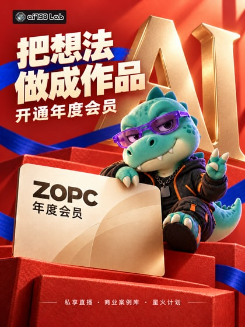</a><br><strong>S04 巨型字雕</strong><br>示例：小恐龙<br><a href="skills/zopc-commercial-visual-posters/assets/styles/S04.png">查看 PNG 原图</a></td>
<td align="center" width="33%"><a href="skills/zopc-commercial-visual-posters/assets/styles/S05.png">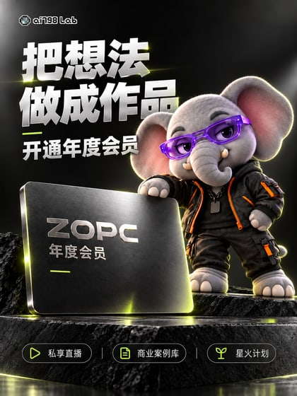</a><br><strong>S05 银色旗舰</strong><br>示例：自定义小象示范<br><a href="skills/zopc-commercial-visual-posters/assets/styles/S05.png">查看 PNG 原图</a></td>
<td align="center" width="33%"><a href="skills/zopc-commercial-visual-posters/assets/styles/S06.png">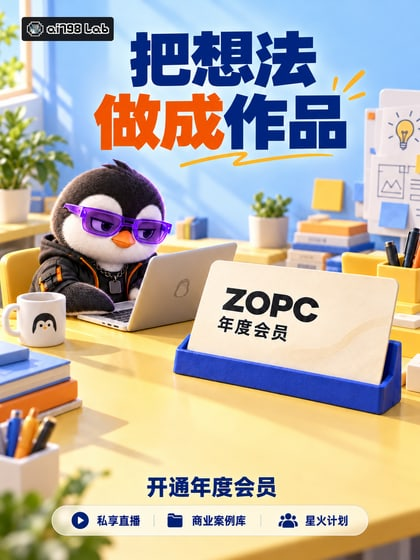</a><br><strong>S06 Builder工作台</strong><br>示例：企鹅<br><a href="skills/zopc-commercial-visual-posters/assets/styles/S06.png">查看 PNG 原图</a></td>
</tr>
<tr>
<td align="center" width="33%"><a href="skills/zopc-commercial-visual-posters/assets/styles/S07.png">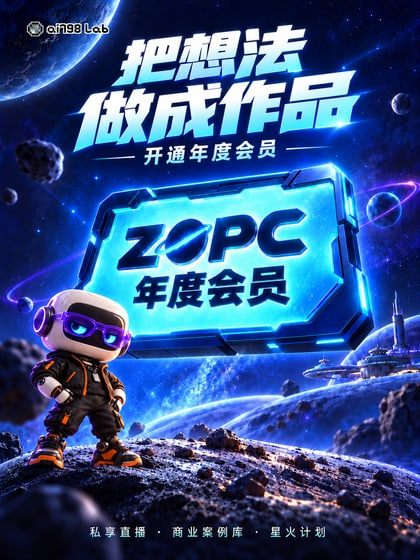</a><br><strong>S07 宇宙巨物</strong><br>示例：机器人<br><a href="skills/zopc-commercial-visual-posters/assets/styles/S07.png">查看 PNG 原图</a></td>
<td align="center" width="33%"><a href="skills/zopc-commercial-visual-posters/assets/styles/S08.png">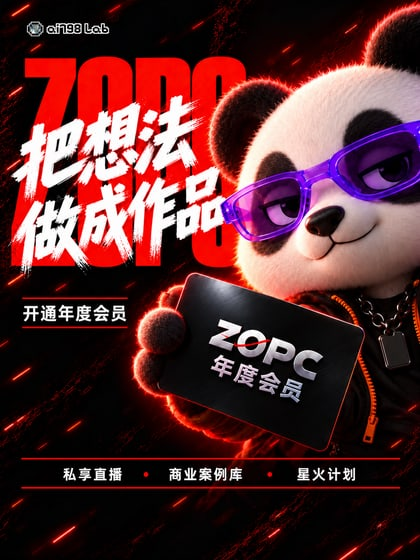</a><br><strong>S08 红黑潮玩</strong><br>示例：熊猫<br><a href="skills/zopc-commercial-visual-posters/assets/styles/S08.png">查看 PNG 原图</a></td>
<td align="center" width="33%"><a href="skills/zopc-commercial-visual-posters/assets/styles/S09.png">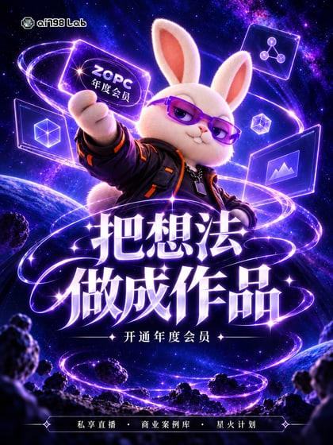</a><br><strong>S09 蓝紫星轨</strong><br>示例：兔子<br><a href="skills/zopc-commercial-visual-posters/assets/styles/S09.png">查看 PNG 原图</a></td>
</tr>
<tr>
<td align="center" width="33%"><a href="skills/zopc-commercial-visual-posters/assets/styles/S10.png">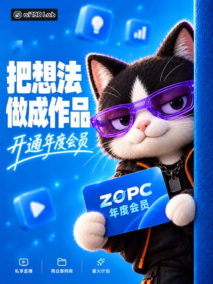</a><br><strong>S10 蓝白毛绒</strong><br>示例：奶牛猫<br><a href="skills/zopc-commercial-visual-posters/assets/styles/S10.png">查看 PNG 原图</a></td>
<td align="center" width="33%"><a href="skills/zopc-commercial-visual-posters/assets/styles/S11.png">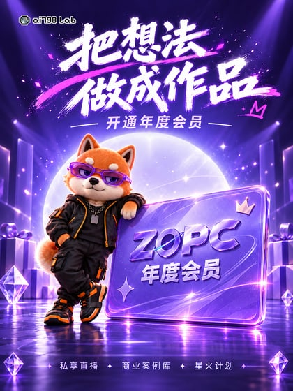</a><br><strong>S11 紫色聚光舞台</strong><br>示例：橙色柴犬<br><a href="skills/zopc-commercial-visual-posters/assets/styles/S11.png">查看 PNG 原图</a></td>
<td></td>
</tr>
</table>

## 安装与使用

推荐在 Codex 对话中输入：

```text
$skill-installer install https://github.com/ai798-Lab/zopc-commercial-visual-posters/tree/main/skills/zopc-commercial-visual-posters
```

安装后在新对话中输入：

```text
使用 $zopc-commercial-visual-posters，帮我做一张运营海报。
```

制作流程：**选视觉形象 → 看编号样式 → 选择样式 → 补充活动信息 → 生成并检查 → 询问是否延展**。

也可以一次说清楚：

```text
使用 $zopc-commercial-visual-posters。
形象选 M03 机器人，样式选 S08 红黑潮玩。
活动标题：周末 AI 工具分享会
副标题：把问题带来，一起解决
平台与比例：小红书，3:4
品牌：实验室朋友
引导：收藏这场分享
不需要价格、赠品和二维码。
```

已提供的信息不会重复询问。需要二维码时使用当次提供的真实原码；无二维码版会重新排版。

[查看完整安装步骤、手动安装和常见问题](docs/INSTALL.md)

## 文件与发布范围

| 内容 | 位置 |
| --- | --- |
| 可安装的 Skill | [skills/zopc-commercial-visual-posters](skills/zopc-commercial-visual-posters) |
| 10 个吉祥物原图 | [assets/mascots](skills/zopc-commercial-visual-posters/assets/mascots) |
| 自定义小象示范 | [assets/custom-example](skills/zopc-commercial-visual-posters/assets/custom-example) |
| 11 张独立海报原图 | [assets/styles](skills/zopc-commercial-visual-posters/assets/styles) |
| 完整总览与两页样式图册 | [assets/galleries](skills/zopc-commercial-visual-posters/assets/galleries) |
| 公开版范围 | [素材范围说明](skills/zopc-commercial-visual-posters/references/history.md) |

本公开仓库仅包含新版素材与安装使用说明，不包含历史原稿。日常制作以当前 S01–S11 样张与用户新资料为准。

目录与校验脚本使用 Python 3 标准库，不会生成海报或联网。实际出图需要当前客户端可用的图片生成/编辑能力；用户的图像和文案会交由该能力处理。Skill 不会自动发布成品到外部平台。

[维护与素材检查](docs/MAINTAINING.md)
